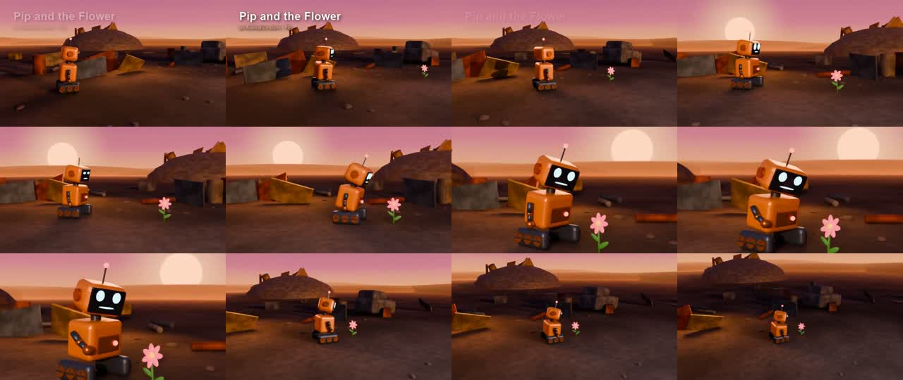
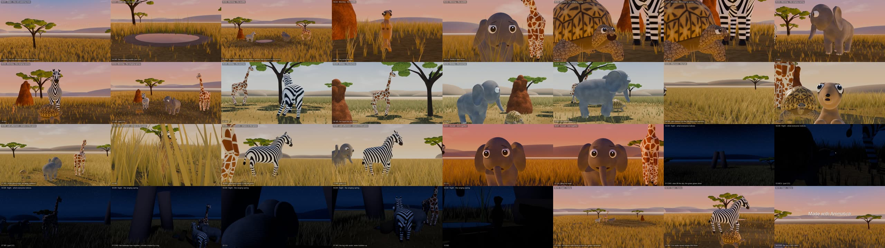

# Animatica — an AI-native animation studio

> 🌱 **Early-stage and built in the open.** Animatica is a few weeks old: the results are rough in places and
> improving every day. Every bug we find becomes an automatic check, so the same mistake can't happen twice.
> **Contributors of every kind are welcome:** see [How you can help](#how-you-can-help).

Describe a short film; a **team of specialist AI agents** plans it, builds it in **Blender**, animates it,
voices it, lip-syncs it, scores it, critiques its own previews, and renders an **MP4 with sound** — and
leaves you a **normal, editable `.blend`** you can open, change by hand, and hand back to the agents.

```bash
animatica film "A curious little robot discovers a flower growing in a junkyard at sunset. It says: 'Hello, little one.'"
```

**Showcase** — made by the command above, fully offline (scripted planner, Kokoro voice, Rhubarb lip sync,
procedural music, Cycles 640×360 `--quality draft`: 2 min on an RTX 5060 with OptiX, ~21 min on 2 CPU cores), no human edits:

[](examples/showcase/hello-little-one/final.mp4)

▶ [`examples/showcase/hello-little-one/final.mp4`](examples/showcase/hello-little-one/final.mp4) (21 s, with sound and captions) ·
[production log](examples/showcase/hello-little-one/log/index.html) ·
[editable .blend](examples/showcase/hello-little-one/scene.blend) ·
**[HD 960×540 version](examples/showcase/hello-little-one-hd/final.mp4)** ·
**[fox film, HD](examples/showcase/fox-lantern/final.mp4)** ("A tiny fox finds a glowing lantern in a snowy forest at night…") ·
games track: [robot-flower-platformer](examples/showcase/robot-flower-platformer/) (screenshot below)


### Latest: *Tembo and the Singing Spring* (animatic, 5:16)

Our first long test: a 5-minute kids' story with five savannah animals (an elephant calf, a giraffe, a zebra,
a meerkat and a leopard tortoise), 103 shots from dawn to night, with a different voice for every character
and music written for each scene. The animals walk with gait patterns taken from published locomotion
research: elephants never trot, and giraffes "pace", moving both legs on one side together.

[](examples/showcase/savannah-animatic/animatic_web.mp4)

▶ [`examples/showcase/savannah-animatic/animatic_web.mp4`](examples/showcase/savannah-animatic/animatic_web.mp4)

An **animatic** is the rough cut that studios make before the final render, to judge story, timing and
staging. Known issues we're fixing next: the lip sync drifts, some movements and sound effects are off, the
night scenes are too dark, and one zebra wanders where she shouldn't. The character designs come from the
[design stage](DESIGN_STAGE.md) (design sheets and approval packets are in [`design/`](design/)).

## How you can help

You don't need to be a programmer. Animatica needs:

| You are… | You could… |
|---|---|
| 🎨 **3D artist / character designer** | improve base meshes, sculpt species parts, design new characters, make CC0 textures |
| 🏃 **Animator** | build gait and pose libraries, acting beats, expressions, camera language |
| 🎵 **Musician / sound designer** | write character themes and scene cues, record or synthesise CC0 sound effects |
| ✍️ **Writer / storyteller** | write kids' stories and screenplays, review story structure and dialogue |
| 🧪 **Tester** | run it on your machine (Windows, macOS, Linux; NVIDIA, AMD, Apple GPUs) and report what breaks |
| 💻 **Developer** | Mac (Metal) and AMD (HIP) GPU rendering, the vision critic, the web app, Godot games, tests |

Start with an issue labelled **good first issue** or **help wanted**, or open a Discussion to say hello and
tell us what you'd like to work on. Read [CONTRIBUTING.md](CONTRIBUTING.md) first (licensing rules and a DCO
sign-off on commits). Everyone who contributes is credited in the README and in the end credits of every film
we make.

**On Windows with an NVIDIA GPU?** See [docs/SETUP.md §5](docs/SETUP.md) for the tested setup (OptiX GPU
rendering: an HD short in about 4 minutes on a laptop RTX 5060).

## Quickstart (fresh clone, Linux/macOS, Python 3.13)

```bash
git clone https://github.com/Goon254/3-D-plus-AI && cd 3-D-plus-AI
python3.13 -m venv .venv && . .venv/bin/activate
pip install -e ".[dev]" bpy==5.3.0 kokoro-onnx soundfile mcp   # Blender as a Python module + voice + MCP
scripts/setup_assets.sh            # optional: Kokoro voice model, Piper fallback voices, Rhubarb lip sync
animatica dev doctor               # shows what was found (ffmpeg must be on PATH)
animatica demo --quality preview   # ~2–3 min: fast Workbench render of the north-star short
animatica demo --quality final     # Cycles 960×540 (≈9 s/frame on 2 CPU cores)
```

No API key needed: without `ANTHROPIC_API_KEY` the agents use a deterministic offline "scripted" provider.
With a key, Claude plans the film, chooses performance/camera parameters and reviews previews visually.

Outputs land in `output/<project>/`: `final.mp4`, `scene.blend`, `scene.usda`, `audio/`, and
`log/index.html` — a production log with every agent decision, every batch, and every critic review
with its preview.

## Commands

| Command | What it does |
|---|---|
| `animatica film "<prompt>" [--quality ci/preview/draft/final/high]` | prompt → short film + editable project |
| `animatica demo` | the north-star film |
| `animatica continue <project>` | after you edit `scene.blend` in Blender: your changes are locked and kept; agents redo the rest |
| `animatica revise <project> "make the robot blue and slow down shot 2"` | targeted changes |
| `animatica render <project>` | re-render from the `.blend` |
| `animatica log <project>` | regenerate the HTML production log |
| `animatica dev run-batch examples/batches/robot.json` | execute one protocol batch → `.blend` + preview PNG |
| `animatica dev schema` / `animatica dev doctor` | protocol JSON Schema / environment check |
| `animatica-mcp` | MCP server so Claude (or any MCP client) can drive Animatica directly |

## How it works

```
prompt ─► Director ─► Voice & Sound ─┐
                 └──► Art/Asset ─────┴► Animator ─► Camera & Lighting ─► Critic ⟲ (fix → re-layout) ─► Editor ─► MP4
                       every engine change = one validated batch ──► Blender adapter (separate GPL process)
```

* **Batched operation protocol** — agents never make one tool call per tiny action. A batch of 3 or 3 000
  ops is validated as a whole, executed in one round-trip, and applied as one undo step (rolled back on
  any error). See [docs/PROTOCOL.md](docs/PROTOCOL.md).
* **Parameters over strokes** — the LLM picks style, staging, performance and camera *parameters*;
  procedural recipes turn them into geometry, ~3 000 keyframes, lights and camera moves.
* **Animation principles built in** — anticipation, overshoot, follow-through (spring-simulated
  antenna), secondary motion, squash & stretch, blinks, and Rhubarb lip sync on a shape-key mouth.
* **A Critic that checks real things** — subject in frame (camera-frustum projection), framing size per
  shot type, floor contact, mouth moving during dialogue, exposure — each issue comes with a fix the
  orchestrator applies before re-rendering previews.
* **Artist in the loop** — `continue` diffs your saved `.blend` against the scene model and treats your
  edits as authoritative.
* **Engine-agnostic, USD-shaped core** — the orchestrator and agents don't know Blender; adapters do.

Docs: [Architecture](docs/ARCHITECTURE.md) · [Protocol](docs/PROTOCOL.md) · [Agents](docs/AGENTS.md) ·
[Setup that worked](docs/SETUP.md) · [Decisions](docs/DECISIONS.md) · [License audit](docs/LICENSE_AUDIT.md) ·
[Research](docs/research/README.md) · [Progress](PROGRESS.md)

## Licensing

Core (`src/animatica`): **Apache-2.0**. Blender adapter (`adapters/blender`) and TTS worker
(`adapters/tts_worker`): **GPL-3.0-or-later**, run as separate processes. See [THIRD_PARTY.md](THIRD_PARTY.md).
Contributions need a DCO sign-off — see [CONTRIBUTING.md](CONTRIBUTING.md).
