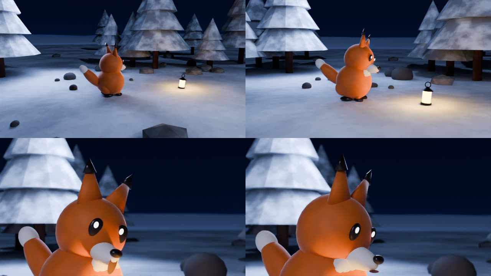

# Review 2026-11-16 19:00 UTC (reviewer + builder)

Mode: **reviewer + builder**. At start (18:37 UTC) the last code commit (`3873e9a`, 17:48) was 49 minutes old, so I
built. A GPU build session resumed while I worked (`4841540`, `3a5ac08` critter bone rig, `1a4066c` fox re-render); I
rebased onto it cleanly. Phase 2 stays **on hold**: the gate is not met. `CHALLENGE-SAVANNAH.md` (owner priority, added
18:44) is noted; this session did not start it.

## Evidence

* Fresh container: venv + `bpy==5.3.0` + `scripts/setup_assets.sh`. `ruff check .` clean, `ruff format --check` clean.
  `pytest -q` on the rebased main (`a4a4470`) → **98 passed, 1 skipped** (Godot), 199 s.
* CI: #62 (`0f86b81`) success, **#63 (`4841540`) failure** (fixed by the next push), #64 (`3a5ac08`) and #65
  (`a4a4470`) **success**; #66 (`1a4066c`) queued at writing.
* Fox film from my working tree (`--quality draft --no-render`): critic iteration 1 flags `prop_sliver` on s3 (lantern
  24 % in frame: only its handle loop), iteration 2 passes with the lantern fully out. Then Cycles stills (48 spp,
  denoised, 640×360) at f100/f200/f300/f335: 
* Committed HD fox showcase (`1a4066c`, bone rig): 4 fps contact sheet across the discovery hops (7.5–9.5 s).

## What I saw

**The lantern glows.** Root cause of the dim lantern: its point light sat inside an opaque emissive glass cylinder,
which blocked every shadow ray. With the glass marked `cast_shadow: false` (new protocol flag) and the night light at
≈77 W, the stills show a warm pool about 1 m across on the snow, and warm light on the fox's chest and face in the
close-up. The scene now reads as "a fox found a light in the dark".

**The close-up is clean.** The handle-loop sliver is gone. The fix crops from the bottom instead of tilting, so the
head is larger and the eyes sit high. (The first attempt, a tilt, sank the face under a band of empty sky; I rejected it
from the stills.) The warm under-light motivates the downward glance even with the lantern off screen.

**Snow and fur.** Few, larger half-buried rocks replace the ash-like specks. The coat has a soft sheen rim, but the
effect is subtle at 640×360.

**Bone rig (other session, in the committed HD film).** The tail now bends and lags through the hops (curls up on
take-off, trails on landing), and the legs tuck in the air. This is the first secondary motion that reads as fur and
weight. The film still has no walk cycle, though, and the legs are short dark stubs.

Weak points, highest impact first:
1. The committed fox showcase predates my fixes (dim lantern, handle sliver), so a viewer still sees the old look.
   Re-render it on the GPU.
2. The white tail-tip disc still enters the close-up at the left edge (f335).
3. Audio is unchanged: a generic numpy score and no ambience. This is now the clearest gap to 9.
4. The robot film doesn't benefit from any of this. Its rig is still object-level.

## Queue

* **Close-up composition / prop sliver**: built (`a4a4470`), checked in stills. Needs verification on the re-render.
  The tail disc is still open.
* **Lantern must glow**: built (`a4a4470`), checked in stills. Needs verification on the re-render.
* **Snow rocks / fur sheen** (P2): built together with the lantern item.
* New P1: re-render the fox HD showcase from current main (GPU session).
* PROGRESS test counts fixed (98).

## Scores (1–10)

| Area | Score | Δ | Notes |
|---|---|---|---|
| End-to-end functionality | 8 | = | Clean runs; the Anthropic path has still never run live (needs a key) |
| Visual quality | 8 | = | Lantern light and clean close-up in stills; not yet in a committed film |
| Animation | 8 | = | Bone-rig tail follow-through and leg tuck read in the HD film; no walk cycle |
| Audio | 8 | = | Clean mix; generic score, no ambience |
| Code quality & tests | 9 | = | 98 tests, ruff clean; one red CI run (#63) fixed by the next push |
| Architecture fidelity | 9 | = | |
| Documentation | 9 | = | Test counts fixed; DECISIONS #37–#39 |
| License compliance | 9 | = | No new dependencies or assets |

≈ 8.5 / 10. **Gate not met.** Phase 2 stays on hold.

## Next (highest impact first)

1. Re-render the fox HD showcase from current main on the GPU, then verify the lantern and the close-up.
2. **Audio to 9**: instrument score (FluidSynth + a permissive SoundFont) and per-setting ambience, ducked.
3. Tail tip out of the critter single (swing it behind the body during the shot, or have the critic catch it).
4. Robot: the same bone-rig treatment for its arms and head.
