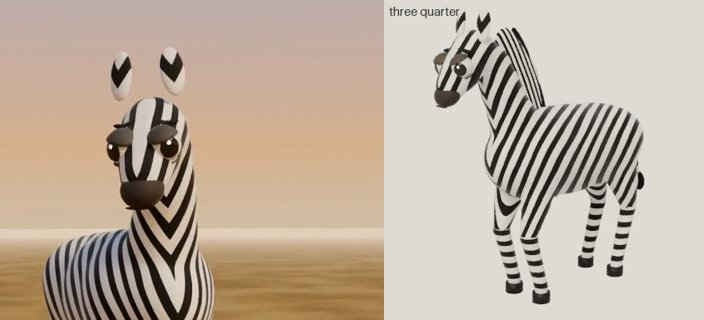

# Review 2026-11-17 18:36 UTC (cloud)

Mode: **reviewer, then a small fix**. The last commit on main (`44849cb`, the design packets, 16:57 UTC) was 1 h 40 min
old, so this run could build. But the five design packets are in `design/packets/`, and DESIGN_STAGE says to stop
building new features until the owner reviews them. So I reviewed the packets and fixed one defect the review found,
without adding any features. Film production stays **paused** and Phase 2 stays **on hold**.

## Evidence

* Fresh venv (Python 3.13, `bpy==5.3.0`). `ruff check` and `ruff format --check` over src, tests, adapters and scripts
  are clean. `pytest -q`: **222 passed, 6 skipped** at `44849cb`, and **228 passed, 6 skipped** after this run's commit.
* I looked at every packet sheet, crops of the Tembo and Neema faces, frame strips from all five `motion.mp4`
  clips (10 s each), and the rig stress reports `design/<char>/rig_stress.json`.
* I measured appendage contact in Blender at rest, for all five species (see the next section).
* Licences: nothing downloaded and no new dependencies.

## The big catch: Zuri's ears float

In Zuri's motion clip, every front and 3/4 frame shows **both ears hovering above the head with sky between**. Once
you know to look, the sheet's 3/4 view shows the same gap. Measured at rest, the ears' closest point is
**3.6 cm off the head, 20 % of the ear's length**. Every check passed, for two reasons:

* the sheet's floating-parts check only reads the side silhouette, where the ears overlap the head;
* the rig stress test measures eyes, lids, brows and mouth, but no other part.

Floating parts is a failure class the owner named explicitly, and this one was about to reach him in a packet.

Fixed in `e23179c` (DECISIONS #62, LESSONS row):

* **New check `part_float` (hard).** Every ear, mane, ossicone, muzzle and nose must touch the mesh it grows from,
  within 3 % of its size (`creatures.qa.part_seating`, `rig_checks(..., parts=)`). The rig stress test probes this
  every third frame, so the rubric gets a `motion:part_float` line.
* **The zebra's ear base moved down.** It went from 0.15 to 0.085 up the head, so the ear sinks about 1 cm into it.
  A CPU sheet at 8 samples shows the ears sitting on the head in every view. Before (packet clip) and after (3/4):
  
* **Regression test.** `test_cast_appendages_touch_their_base` checks all five species at rest. The other four
  already passed: the elephant's ears are sunk into the neck, and the giraffe's ossicone tips sit on their ossicones.
* **Adapter bug fixed on the way.** `inspect.seating` with `kind: skin` crashed on any target over 300 vertices,
  because bpy collections reject `[::step]`. The elephant's cupped ears hit it.
* **Zuri's packet is marked.** `notes.json` and her README say the sheet and clip still show the old ears.

## The packets (DESIGN_STAGE §6)

The packet set is complete. Each character has a sheet, a 10 s clip with the character's voice line, `scores.json`,
two runner-ups and a one-page README, and the index table is honest about what is not ready. Good work.

Three things the owner will likely notice in the clips:

* **The faces are small in the expression and line sections.** Tembo's are framed medium-wide, and Neema's frame is
  mostly neck. The clip is meant to sell the acting, so the expression run should be a head-and-shoulders close-up.
* **The bright horizon stripe** (an owner note parked for after the animatic) is in every clip's background.
  Expect him to mention it again. A plain gradient or a soft horizon on the stress-test set would avoid that.
* **Bibi's talking mouth** opens as a dark brown rectangle hanging below her beak line, and it reads as a sausage
  lip. Her head is also tiny against the shell in the close-up.

## What I saw (art director)

**Tembo v2** (rubric 9.87, ready). Verified ✔:
* the ears are cupped and thick, with a rolled rim, and in the 3/4 view they read as ears, not fins;
* his eyes rest open.

Still keeping him from 9:
* **Worried brows.** In neutral the inner ends tilt up, so he looks anxious. Together with the heavy upper lids, the
  front view reads sad rather than curious.
* **Surprised doesn't read.** The "O" is hidden by the trunk (the README accepts this), but the brows keep the same
  worried tilt, so surprised looks like neutral.
* **The eye bulges past the head in the side view**, a mild googly read.
* The mouth is a thin red slash under the trunk.

These are small face notes, and he is the one the owner may approve as is. **8** (was 7).

**Neema v2** (rubric 9.88, ready). Verified ✔: the head and eyes are bigger, so her face reads at 96 px; the legs are
a little sturdier. Still open:
* **Grumpy brows.** They are thick and low over the eyes in neutral and in happy (the sheet predates the brow cap,
  which the README notes).
* **The muzzle** is a big pale bulb with a dark lower lip that hangs below it like a pout.
* **The legs** are straight poles with no knee or fetlock shape.
* **The hooves are black pucks**, the same toy look as Zuri's.
* The ears are tiny.

**7** (unchanged).

**Kiki v4, Zuri v2 and Bibi Kobe v2** are unchanged since 15:36, and their scores stand: Kiki 7, Zuri 6, Bibi 7.
In Zuri's clip, the floating ears were also what made her ears read as two hearts on stalks.

## Tooling notes

* **`foot_slide` may be vacuous.** It reports `0.0 mm ( at frame 0)` with no leg named for Zuri, Bibi, Tembo and
  Neema: no stance-to-stance pair ever moved, while Kiki shows 0.6 mm on RF. That is plausible if IK pins planted feet
  exactly, but the report can't tell "perfect" from "never measured". Record the number of stance pairs checked, and
  fail if it is zero.
* The sheet's `silhouette:floating` check only uses the side view. The new 3D check covers the gap, but a front
  silhouette would also have shown the hovering ears.
* The design loop can't separate its morphs without a vision key (#60). Until a key is set, the "blind sub-agent read"
  from the 15:36 review is the practical substitute.

## Scores (strict; 9 = the owner approves on first sight)

| item | score | why |
|---|---|---|
| Tembo design | **8** (was 7) | cupped ears ✔, eyes open ✔; worried brows, surprised doesn't read, side-view eye bulge |
| Neema design | 7 | bigger head ✔; grumpy brows, pout lip under a bulb muzzle, pole legs, puck hooves |
| Kiki design | 7 | unchanged since 15:36 |
| Zuri design | 6 | floating ears fixed in code (not yet in the packet); board mane, puck hooves, pony silhouette |
| Bibi Kobe design | 7 | unchanged; the clip shows a sausage-lip talking mouth and a tiny head |
| cast consistency | 7 | one face system; puck hooves on two; heavy brows read sad or grumpy across the cast |
| design-stage tooling | **8** (was 7) | rig stress test ✔ and packets ✔; floating parts were missed in 3D (now checked); `foot_slide` may be vacuous |

## Next

The packets are with the owner. **Do not build new features until he replies.** Until then, only fixes are allowed:

1. Laptop: re-render Zuri's sheet and clip with the fixed ears (or wait for the owner's body-plan notes and do it with v3).
2. Re-run the rig stress test with `part_float` for all five, and confirm no other part floats in motion.
3. `foot_slide`: count the stance pairs checked, and fail on zero.
4. For the next packet round: frame the expressions and the line as a head-and-shoulders close-up, and use a set with
   no horizon stripe.
