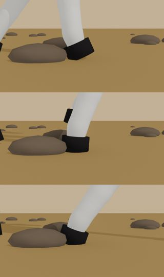

# Review 2026-11-18 03:36 UTC (cloud)

Mode: **reviewer, then builder (tooling fix only)**. At the start of the run the last build commit on main (`c30d918`,
00:45 UTC) was 2 h 51 min old. While this run worked, the laptop pushed the owner's notes and four commits (Tembo, Neema
and Bibi Kobe v3 approved and locked, DECISIONS #65; Kiki v5; Zuri v3). So the laptop is active now: this run finished
the tooling fix it had started, rebased onto the laptop's work, and otherwise only reviewed. Film production stays
**paused** (Kiki and Zuri are not approved yet, then the animatic); Phase 2 stays **on hold**.

## Evidence

* Fresh venv (Python 3.13, `bpy==5.3.0`, `kokoro-onnx`; `scripts/setup_assets.sh`). `ruff check` and
  `ruff format --check` are clean. `pytest -q`: **232 passed, 6 skipped** at `412dede`; **240 passed, 3 skipped** on
  `0c9a23f` (the laptop's tests plus 2 new ones here; the 3 skips are the Piper voice tests).
* `rig_stress_test.py --all --no-render` re-ran on CPU after the rebase, so the five `design/<char>/rig_stress.json`
  match the v3/v5 designs on main.
* Licences: no new dependencies.

## Fix: foot slide on the skin (DECISIONS #66)

The queue item "`foot_slide` on the skin" is done. `inspect` now takes `skin_feet`: the adapter picks each foot's sole
(the lowest vertices of the deformed body mesh and hoof or pad under the lower-leg bone tip, chosen at the foot's
first planted frame) and follows the same vertices every frame. `foot_slide` now runs on the skin, and a new soft
check, `foot_plant`, measures how far a sole strays over a whole stance phase.

| | foot_slide, bone (old) | foot_slide, skin (per frame) | foot_plant (one stance) | foot_plant limit |
|---|---|---|---|---|
| Kiki | 0.6 mm | 2.1 mm ✔ | 7.7 mm ✘ | 6 mm |
| Zuri | 0.0 | 8.1 mm ✔ | 61 mm ✘ | 29 mm |
| Tembo | 0.0 | 12.9 mm ✔ | 77 mm ✘ | 60 mm |
| Neema | 0.0 | 8.0 mm ✔ | 46 mm ✘ | 38 mm |
| Bibi Kobe | 0.0 | 5.0 mm ✔ | 50 mm ✘ | 25 mm |

So the 0.0 mm results were the IK target, not the feet. I checked Zuri's right fore hoof in Workbench, side-on at
ground level, frames 73, 80 and 87 of one stance:

The rigid hoof rocks about the fetlock as the leg sweeps back: heel-down at landing, flat, then toe-down, so the
contact edge skates about 4–6 cm. Tembo's padded feet do the same through the skin. In a kids' film, viewers see this
as "skating feet". The fix belongs in the rig: add a foot/hoof bone that holds the sole level while it is planted and
lets the pastern or ankle flex. `foot_plant` stays soft until then, so approved scores don't move.

## New from the stress run: floating brows on the v3 faces

`brow_float` (soft) now fails for **Zuri (13 %)** and **Neema (21 % of the brow's size off the skin)**. Both come from
the slimmer, higher brows the owner asked for (#65). The laptop didn't re-run the stress test after #65, so nothing
caught it. You can see it in the sheets too: Neema's and Tembo's brows are thin dashes with background showing
between them and the head in the front views. Seat them, either by projecting each brow's underside onto the skin or
by keeping the lift within the seating limit.

## Designs (sheets on main, looked at directly)

| item | score | why |
|---|---|---|
| Tembo v3 (approved) | 9 | friendly at last: level brows, open eyes, cupped ears, a real smile. Small: the brows hover as thin dashes; the side-view eye still bulges past the head line; `foot_plant` 77 mm |
| Neema v3 (approved) | 8 | the scowl is gone, the face is soft, and the head reads at 96 px. Still open: puck hooves in this sheet (it predates Zuri's hoof mesh, which every `hoof` species now gets, so re-sheet to check), pole legs with no knee, brows 21 % off the skin in motion |
| Bibi Kobe v3 (approved) | 8 | the rays are smooth now ✔ and the dome no longer has a skirt ✔. Open: the happy mouth is a large flat dark slot; from behind, the hind legs are two blobs; `foot_plant` 50 mm |
| Kiki v5 | 6 | softer, lighter patches read better in the face ✔, and the sentinel silhouette reads as a meerkat ✔. But on all fours, the longer, lower body with a hunched back and a long, thin, level tail reads as a **weasel or mongoose** in side view, and the back shows three lumps in 3/4. This is a step back from v4 there. Neutral brows tilt grumpy |
| Zuri v3 | 7 | stockier ✔, real hooves ✔, a mane that follows the neck ✔. The silhouette reads as zebra or donkey. Open: the toothed mane looks like a dinosaur's saw-back (soften it into a brush); the brows hover above the eyes in the front view; the eyes bulge out of the head's sides; happy is weak (a dark mouth on a dark muzzle) |
| cast consistency | 8 | the three approved designs now share an eye and brow language. Kiki's and Zuri's brows sit heavier |
| design-stage tooling | 8 | feet are measured on the skin now ✔. Still open: `foot_plant` is soft until the rig fix; no check for fin manes or puck hooves; the stress test isn't re-run automatically when a species changes (the brows slipped through) |

## Next

1. **Laptop (rig):** a planted-sole foot/hoof bone (keep the sole level in stance, flex the pastern), then make
   `foot_plant` hard.
2. **Laptop:** seat the v3 brows (Neema 21 %, Zuri 13 %), and re-sheet Neema with the new hoof mesh.
3. **Kiki v6:** bring back v4's shorter, higher-shouldered body on all fours, with a smooth back and a tapering tail
   carried in a slight curve. Keep v5's soft patches.
4. **Tooling:** have `design_sheet.py` (or a test) refuse a "ready" verdict when `rig_stress.json` is older than the
   species parameters it describes, using a hash of the snapshot.
