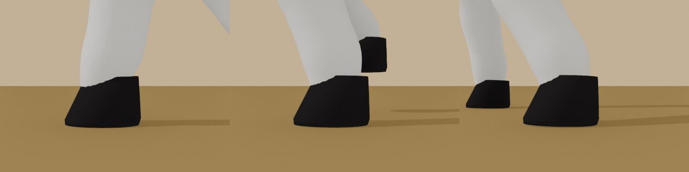
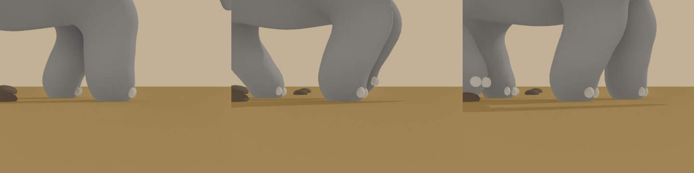

# Review 2026-11-18 06:36 UTC (cloud)

Mode: **reviewer, then builder**. The last build commit on main (`d8b3e5d`, the laptop's animatic tooling, 04:47 UTC)
was 1 h 50 min old. The owner hasn't replied on Kiki v5 or Zuri v3 yet, so no designs changed here. Fixes only:
two tooling items and the top rig item from the queue. Film production stays **paused**, and Phase 2 stays
**on hold**.

## Evidence

* Fresh venv (Python 3.13, `bpy==5.3.0`, `kokoro-onnx`, `scripts/setup_assets.sh`). `ruff check` and
  `ruff format --check` are clean. `pytest -q`: **242 passed, 3 skipped** at `d8b3e5d`; **247 passed, 3 skipped**
  after this run (5 new tests; the 3 skips are the Piper voice tests).
* `rig_stress_test.py --all --no-render` re-ran twice on CPU (after #68, then after #69); all five reports on main
  match the code and species on main, and their fingerprints prove it.
* Licences: no new dependencies.

## Built

1. **Stale stress reports can't pass any more (DECISIONS #68).** Each `rig_stress.json` now stores a fingerprint of the
   species parameters and of the rig code it measured. The rubric adds `motion:fresh` (hard) and `motion:fresh_code`
   (soft), and a test fails when a species changes without a stress re-run. This closes the hole that let the #65
   brows through.
2. **The packets' index was stale, and it's the first page the owner opens.** `design/packets/README.md` still
   listed Kiki v4 and Zuri v2, and Tembo and Neema as "ready v2". It is now generated from the packets'
   `scores.json` and `approved.json` (`design_packet.py --index`), with a per-character "asks of you" taken from
   `notes.json`. A test keeps it in sync.
3. **Planted feet no longer skate (DECISIONS #69).** Each leg gets a foot bone that keeps its rest orientation, so
   the sole stays level and pinned while the shin flexes over it:

| `foot_plant` (one stance) | before | after | limit |
|---|---|---|---|
| Tembo | 77 mm | **21 mm** ✔ | 60 mm |
| Neema | 46 mm | **23 mm** ✔ | 38 mm |
| Bibi Kobe | 50 mm | **3.2 mm** ✔ | 25 mm |
| Zuri | 61 mm | **8.9 mm** ✔ | 29 mm |
| Kiki | 7.7 mm | 7.1 mm ✘ | 6 mm |

Kiki's hind paws keep the old hinge. A level hind paw tore her heel skin as she rose into the sentinel (5.9 mm
per frame, a hard failure), so she is 1.1 mm over a 6 mm limit on a 12 mm paw. You can't see that, but the
check is honest. `foot_plant` stays soft until her heel gets a proper bone (a heel pivot used only in the sentinel).

## Designs (no changes since 03:36; Neema's re-sheet with the hoof mesh checked)

| item | score | why |
|---|---|---|
| Tembo v3 (approved) | 9 | unchanged; his feet now stay planted ✔ |
| Neema v3 (approved) | 8 | the re-sheet has real dark hooves, not pucks ✔, and her feet stay planted ✔. Open: pole legs with no knee or fetlock shape; in the side view the eyes bulge past the head line; the brows barely show in the close-ups (they're seated now, at the cost of reading) |
| Bibi Kobe v3 (approved) | 8 | unchanged; the best foot plant of the cast now (3 mm). Open: the flat dark slot of a happy mouth; two blobs for hind legs from behind |
| Kiki v5 | 6 | unchanged: on all fours she reads as a weasel (long low body, three lumps on the back, long level tail). Her neutral brows still tilt grumpy. Waiting on the owner (v5 follows his note; the reviewer prefers v4's body) |
| Zuri v3 | 7 | unchanged: zebra or donkey from the silhouette, saw-tooth mane, a weak happy |
| cast consistency | 8 | unchanged |
| design-stage tooling | 9 | stale reports are now caught ✔, the index can't drift ✔, and feet are fixed in the rig and measured on the skin ✔. Still open: `foot_plant` is soft (Kiki); no check for fin manes or puck hooves; packets still show pre-#69 clips |

## Needs the laptop (GPU)

* Re-render the five stress takes (`rig_stress_test.py --all`) and rebuild the packets (`design_packet.py --all`) so
  the clips show the planted feet. The rest pose didn't change, so the sheets and approvals stand.
* Before the animatic renders anything, pull: #69 changes how every walk looks.

## Next

1. Owner: Kiki (which body on all fours) and Zuri (approve or notes). See the asks in `design/packets/README.md`.
2. Kiki: a heel pivot for the hind paws (level in the walk, hinged in the sentinel), then make `foot_plant` hard.
3. Laptop: re-render the stress takes and packets (above).
4. Zuri v3 polish (brush mane, eyes sunk into the head, a readable happy) and Kiki v6, once the owner has replied.
