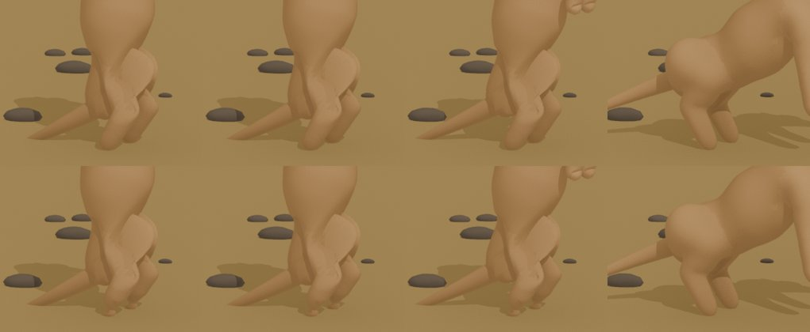

# Review 2026-11-18 09:36 UTC (cloud)

Mode: **reviewer, then builder**. The last build commit on main (`b24bf3d`, this queue's own #69 at 07:13 UTC) was
2 h 24 min old, and nothing new has come from the laptop or the owner since 06:36. No designs changed. Fixes
only: the top rig item from the queue. Film production stays **paused**, and Phase 2 stays **on hold**.

## Evidence

* Fresh venv (Python 3.13, `bpy==5.3.0`, `kokoro-onnx`, `scripts/setup_assets.sh`). `ruff check` and
  `ruff format --check` are clean. `pytest -q`: **249 passed, 2 skipped** at `b24bf3d`; **250 passed, 2 skipped**
  after this run (1 new test).
* `rig_stress_test.py --all --no-render` re-ran on CPU (2 min 44 s): **all five pass every check**, with
  `foot_plant` now hard. Fingerprints refreshed (perform.py is rig code).
* Licences: no new dependencies.

## Built: Kiki's heel (DECISIONS #70)

Her hind paws now stay level like everyone else's, and they pivot at the heel into the sentinel. The foot bone is
counter-rotated by the body's sentinel pitch, so the sole stays flat on the ground as she rises. On all fours the
key is zero. The first attempt at a level hind paw (#69) failed because the paw tipped toes-up with the body.

| Kiki | before (hinged) | after (heel pivot) | limit |
|---|---|---|---|
| `foot_slide` per frame | 2.1 mm | **0.5 mm** | 4 mm |
| `foot_plant` per stance | 7.1 mm ✘ | **1.6 mm** ✔ | 6 mm |

`foot_plant` is now **hard** for the cast (all five: 1.6–23 mm against 6–60 mm limits). New
`rig_stress_test.py --stills` renders Workbench previews at chosen frames, so a cloud session can look at a pose
without a GPU. Seen in the same stills, not new: the sentinel thighs show soft creases where the hind leg folds
under the hips. They're small at film distance, but worth a corrective shape later.

## Designs (no changes since 03:36)

| item | score | why |
|---|---|---|
| Tembo v3 (approved) | 9 | unchanged |
| Neema v3 (approved) | 8 | unchanged: pole legs, eyes past the head line in the side view, faint brows |
| Bibi Kobe v3 (approved) | 8 | unchanged: the flat dark slot of a happy mouth; hind legs are blobs from behind |
| Kiki v5 | 6 | the design is unchanged (weasel read on all fours, grumpy neutral brows); her feet are now the best planted in the cast. Waiting on the owner |
| Zuri v3 | 7 | unchanged: zebra or donkey from the silhouette, saw-tooth mane, a weak happy |
| cast consistency | 8 | unchanged |
| design-stage tooling | 9 | `foot_plant` is hard and passes for all five ✔; CPU stills for pose review ✔. Still open: no check for fin manes or puck hooves; packet clips predate #69/#70 (laptop) |

## Needs the laptop (GPU)

* Re-render the five stress takes (`rig_stress_test.py --all`) and rebuild the packets (`design_packet.py --all`):
  the clips still show skating feet and Kiki's old heel. Rest poses haven't changed, so sheets and approvals stand.
* Pull before the animatic renders anything: #69 and #70 change every walk and Kiki's sentinel.

## Next

1. Owner: Kiki (which body on all fours) and Zuri (approve or notes): see `design/packets/README.md`.
2. Laptop: re-render the stress takes and packets (above).
3. Zuri v3 polish and Kiki v6, once the owner has replied.
4. Tooling (fixes-only scope): a hard check for a mane that stands as a fin and for hooves that read as flat pucks
   (both caught only by eye so far).
