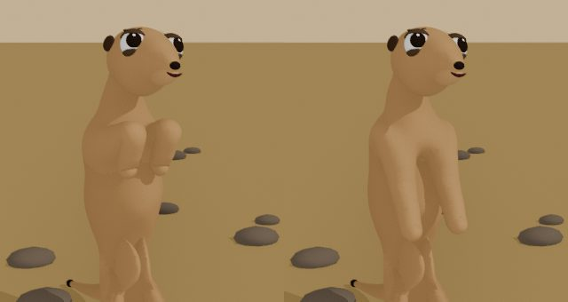

# Review 2026-11-18 15:36 UTC (cloud)

Mode: **reviewer, then builder**. The last build commit on main (`b5b3991`, #71 at 12:58 UTC) was 2 h 38 min old,
and nothing new has come from the laptop or the owner since (no new commits, no issues). No designs changed.
Fixes only: the top tooling item from the queue. Film production stays **paused**, and Phase 2 stays **on hold**.

## Evidence

* Fresh venv (Python 3.13, `bpy==5.3.0`, `kokoro-onnx`, `scripts/setup_assets.sh`). `ruff check` and
  `ruff format --check` are clean. `pytest -q`: **253 passed, 2 skipped** at `b5b3991`; **255 passed, 2 skipped**
  after this run (2 new tests).
* `rig_stress_test.py --all --no-render` re-ran on CPU (2 min 20 s): **all five pass every check**, including the new
  one. Apart from Kiki's new `sentinel_paws`, every measurement is identical to 12:36; only the rig-code fingerprints
  changed (`gait.py` is rig code).
* Licences: no new dependencies.

## Built: the sentinel paw tuck is measured (DECISIONS #72)

Kiki's sentinel (paws tucked at the chest, tail as a tripod) is her signature pose. A v2 sentinel with a dangling paw
was caught only by eye (11-17 06:36), and since then only the tail's ground contact was measured. The stress test now
reads the torso's axis (`hips` → `chest` bone tips) and checks the fore paws in every fully-stood frame, in shares of
the fore-leg chain:

| measure | Kiki v5 (tucked) | tuck switched off (arms hang) | limit |
|---|---|---|---|
| lift (lowest paw above the ground) | 1.97 | 1.41 | ≥ 1.0 |
| reach (furthest paw from the torso's axis) | 0.52 | **0.80 ✘** | ≤ 0.65 |
| head-to-paw drop (min–max) | 1.13–1.34 | **1.75–1.93 ✘** | 0.4–1.55 |
| spread (paw heights) | 0.00 | 0.02 | ≤ 0.15 |
| frames measured | 185 | 185 | > 0 |

Workbench stills, frame 250 (left: main; right: the tuck disabled by a temporary local edit, not committed). Two
independent limits catch the hanging arms. The left still also shows what is still open: the folded forearms read as
two soft loaves rather than small paws with fingers, and the thigh crease where the hind leg tucks under (queue).

## Designs (no changes since 03:36)

| item | score | why |
|---|---|---|
| Tembo v3 (approved) | 9 | unchanged |
| Neema v3 (approved) | 8 | unchanged: pole legs, eyes past the head line in the side view, faint brows |
| Bibi Kobe v3 (approved) | 8 | unchanged: the flat dark slot of a happy mouth; hind legs are blobs from behind |
| Kiki v5 | 6 | unchanged: weasel read on all fours, grumpy neutral brows. New note from today's stills: in the 3/4 front view the eyeballs bulge past the top of the head's outline (googly); the sentinel's forearms are loaf-shaped, no paw read. Waiting on the owner |
| Zuri v3 | 7 | unchanged: zebra or donkey from the silhouette, saw-tooth mane (measured, soft fail), a weak happy, heavy sleepy lids in the front view |
| cast consistency | 8 | unchanged |
| design-stage tooling | 9 | the sentinel pose is now measured ✔ (tail and paws). Still open: packet clips predate #69/#70 (laptop); eyes bulging past the head outline has no 2D check on the 3/4 view |

## Needs the laptop (GPU)

* Re-render the five stress takes (`rig_stress_test.py --all`), then `design_sheet.py --rescore` and
  `design_packet.py --all`: the clips still show skating feet and Kiki's old heel, and the rescore picks up #71/#72.
* Pull before the animatic renders anything: #69 and #70 change every walk and Kiki's sentinel.

## Next

1. Owner: Kiki (which body on all fours) and Zuri (approve or notes): see `design/packets/README.md`.
2. Laptop: re-render the stress takes and packets, then rescore (above).
3. Kiki v6 (body, smoother back, tapered tail, eyes seated inside the head outline, small paws in the tuck) and the
   Zuri v3 polish (brush mane passing `shape:mane_brush`), once the owner has replied.
4. Tooling (fixes-only scope): an eye-outline check on the 3/4 view (eyeball silhouette must stay inside the head's
   silhouette except where the brief allows), so googly eyes are caught before a reviewer sees them.
