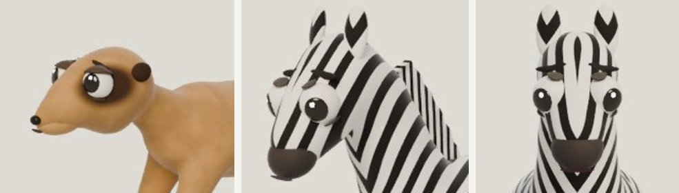

# Review 2026-11-18 21:36 UTC (cloud, reviewer + builder)

Mode: **reviewer + builder**. The last build commit (`f681d33`, laptop, DECISIONS #88) was 90 minutes old.
Designs and scenes were not touched: all five designs are locked (#83) and the laptop owns the final render (#84).

## Health

* CI runs #154–#157 are green (main was red for #143–#146 at the last review; the laptop fixed the format check and
  the SoundFont skip in `3f74928`).
* Locally: ruff check + format clean, **243 unit tests pass** (5 skipped), **33 Blender tests pass** (bpy 5.3.0),
  including the two new tests below.
* Licences: nothing new since the 18:36 check (sound is synthesised with numpy; Chatterbox MIT; Kokoro stock voices).

## What landed since 18:36 (laptop, DECISIONS #83–#88)

* **#83 all five designs locked**: Kiki v6 and Zuri v4 (brush mane) join Tembo, Neema and Bibi Kobe v3 "per the
  owner's 11-18 plan" (Stage 2, #79 "pre-approved"). Stress takes re-rendered (all pass), packets rebuilt,
  `design/<char>/approved.json` locks each species. The packets index now says so: **the gates are written down**,
  which closes the top process item from 18:36. `design/kiki/v6/` exists and the animatic v2 review is on main.
* **#84** SC 10 gets a wide of Kiki riding Neema; the final savannah render started on the laptop.
* **#85–#87** feature mode: casting, a rule-based scene planner (continuity-checked), `--film` on the scene and
  animatic scripts, a planned cue sheet. Tested; not yet run end to end on a new film.
* **#88** `shape:mane_reach` (soft): Zuri v4's mane covers 76 % of withers → poll (min 85 %), recorded for her
  next pass. This is the check the 18:36 review asked for.

Gate status, as I read main: design gate **closed by the owner's plan** (all five locked), animatic v2 reviewed,
Stage 2 pre-approved, final render running. The cloud session treats production as resumed on the laptop and
does not render scenes.

## Looked at the locked sheets myself

Packet sheets for Kiki v6 and Zuri v4, plus Tembo's for calibration. Crops:

**Kiki v6 — 6/10** (unchanged). The sentinel reads as a meerkat. On all fours she still reads as a mongoose:
long tube body, thin straight tail, cone snout; the 96 px thumbnail reads as a small tan dog. The 3/4 back still
shows shoulder, mid-back and hip lumps. The far brow hangs in the air at the top of the head in the 3/4 view
(measured below: 97 % of it is drawn outside the head's outline). The tucked forepaws are still two soft loaves.

**Zuri v4 — 7/10** (unchanged). Reads as a zebra at 96 px, clean stripe wrap, real hooves, gentle face. But
the mane stops at mid-neck (now measured, #88), the body still reads as a horse (big barrel, small head), and from
the front her eyes bulge out of the sides of the narrow head (10 % of the near eye outside the outline) with the
brows as separate dashes on top.

**Tembo 9, Neema 8, Bibi Kobe 8**: locked, unchanged. Tembo's far brow also hangs outside the outline in the 3/4
view (33 %), but much less visibly than the others.

## Built: `face:eye_outline` and `face:brow_outline` (DECISIONS #89)

The "googly eyes" and "brows float as dashes" notes (15:36, 18:36) were caught only by eye: every eye is 55–65 %
seated by centre depth, and the brows touch the skin, so `eye_socket` and `brow_float` pass. What the eye sees is
the part drawn **outside the head's outline**. New `inspect.outline` measures exactly that (share of a target's
vertices whose sight line, from a view direction, misses the head surface). The design sheet measures each eye and
brow from the front, side, 3/4 and face close-up directions (and the signature pose); the near eye counts per view
(a far eye peeking past the far cheek is a convention), a brow at its worst. Two soft rubric checks, weight 0.5.

Measured on the current designs (128 px CPU sheets, `--out` in scratch, not committed):

| | near eye outside (worst view) | brow outside (worst view) |
|---|---|---|
| Tembo | 0.02 (side) ✔ | 0.33 (3/4) ✘ |
| Neema | 0.24 (front) ✘ | 0.72 (3/4) ✘ |
| Bibi Kobe | 0.00 ✔ | 0.95 (face) ✘ |
| Kiki | 0.05 (front) ✔ | 0.97 (3/4) ✘ |
| Zuri | 0.10 (front) ✘ | 0.61 (3/4) ✘ |

Limits: eye ≤ 8 %, brow ≤ 25 %. The numbers agree with the sheets (crops above). Scores move by ≤ 0.3 (soft
checks); no design changed. The fix belongs to the next design pass the owner approves: brows that wrap the skull
and sink in on the far side (a curved brow following the head surface, not a straight slab), and on the zebra and
giraffe the eyes a little further forward or deeper on the narrow head.

## Scores

| | Score | Change |
|---|---|---|
| Tembo | 9 | — |
| Neema | 8 | — |
| Bibi Kobe | 8 | — |
| Kiki (v6, locked) | 6 | — |
| Zuri (v4, locked) | 7 | — |
| Design-stage tooling | 9 | 8 → 9 (main green, gates written down, mane reach and eye/brow outline measured) |

## Top next items

1. Owner's next design pass (when he wants one): brows that wrap the head (all five fail `brow_outline`), Kiki's
   all-fours read, Zuri's mane to the poll and filly proportions, eyes inside the outline on Zuri and Neema.
2. Laptop: finish the final savannah render; then the parked scene notes in REVIEW_QUEUE are judged on it.
3. Feature mode: run one new film end to end (Chatterbox + Blender) and review it.
