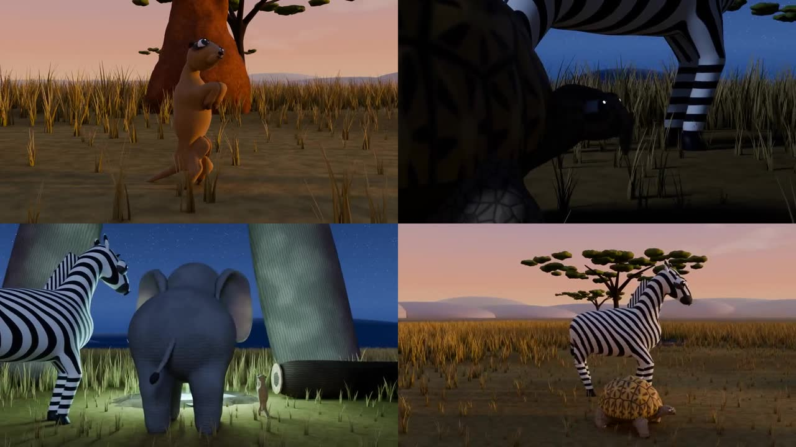

# Review 2026-11-19 00:36 UTC (cloud, reviewer only): the final savannah film

Mode: **reviewer only**. The last build commit (`73be237`, laptop: final film + trailer) was 10 minutes old.
Nothing in `src/`, scenes or designs was changed by this session.

## Health

* CI #158 green; #159 (the film commit, media + PROGRESS only) was running at review time.
* Locally: `ruff check src tests adapters` clean, `ruff format --check src tests adapters scripts` clean (CI's
  scope; a newer local ruff also flags Python blocks inside `docs/research/*.md`, which CI does not check),
  **243 unit tests pass**, 38 skipped (no Blender in this container).
* Licences: the commit adds only renders (web copies, contact sheets, JSON). Nothing new to check.

## The film against CHALLENGE-SAVANNAH.md's definition of done

Watched as frames, one every 6 s across all 10 scenes (53 frames), plus full-size stills of anything suspicious.
Measured the audio with `ebur128`. **I could not listen**: no speakers in the cloud, and the speech recogniser
(faster-whisper) can't download its model through the proxy. So voices and music are not scored.

| Category | Score | Why |
|---|---|---|
| Story | **8** | Clear want (find the spring), a real fork-and-split mistake, a low point at sunset, everyone's trait pays off at night, and a moral that a parent will like ("Fast or slow, tall or small… it takes all of us"). The staging lets it down at the climax (below). |
| Character design | **7** | Tembo is lovely at every size. Neema and Bibi Kobe hold up. Kiki in the sentinel pose (1:18) reads as a **kangaroo**: long feet flat on the ground, a thick tail as a third leg, a long body; on all fours she is still a mongoose (open since 11-18). In 3/4 shots the far brows float beside the heads (#89, still open). |
| Animation / motion | **7** | Walks read and feet stay planted (the hard checks pass). But at **5:06 (SC 10) Zuri's forelegs stand on Bibi Kobe's shell**, and nothing checks for animals walking into each other: the continuity check knows mounds and trees, not actors. Running the path data through the continuity module, actor centres come within **0.20 m** (Tembo–Zuri, end of SC 3) and 0.48 m (Tembo–Kiki, SC 6). |
| Visuals | **7** | Golden hour, the dawn opening with herds and the sunset are the best images the project has made. Against that: the far mountains are smooth pale domes that read as pillows or igloos (1:00, 1:42, 3:06); at the **climax (4:36–4:48)** the spring's light washes the ground a flat pale green, the hollow log's end shows a bright white ring that pulls the eye, and Kiki, the hero of the moment, is seen from behind; SC 8's tortoise close-up (3:48) is nearly black (known); neighbours' legs crowd close-ups at the frame edges (2:30, 3:12, known). |
| Voices | — | Not heard. |
| Music | — | Not heard. Ten per-scene cues exist (`savannah-score/`). |
| Mix | **7** | Integrated **−14.0 LUFS** ✔, LRA 7.1 LU. **True peak +0.5 dBFS** in `film_web.mp4` (over full scale: clips on some players and every lossy re-encode). The trailer is fine (−14.1 LUFS, −2.4 dBTP). |

**Film overall: 7/10.** A real step: it is a watchable five-minute film with a story. It is not done.

Deliverables (CHALLENGE "Output"): the committed cut is `savannah-film/film_web.mp4` at 960×540; the challenge
names `examples/showcase/savannah/final.mp4` at 1280×720 with a poster, captions, `edit.mlt` and a production log
committed alongside. None of those four are in the film folder.

## Design stage scores (unchanged; no designs touched)

Tembo 9, Neema 8, Bibi Kobe 8, Kiki 6, Zuri 7. Tooling 9.

## Added to the review queue

1. **Actors walk into each other** (P0-FILM): a continuity check with an oriented footprint per species (length and
   width from the base meshes, heading from the path) for every on-stage pair, every 0.25 s; then move the SC 10
   and SC 3 marks. A regression test with two overlapping paths.
2. **True peak**: a −1 dBTP limiter after loudness normalisation, measured on the encoded file, not the WAV.
3. **The climax shot**: Kiki's face as she hears the water and as it bursts; tame the spring's bounce light; take the
   white off the log's end cap.
4. **Mountains**: break the domes up (ridges, a little haze-blue gradient), so they read as hills at distance.
5. **Kiki's sentinel silhouette**: shorter, upright hind feet on the toes, a thinner tail resting behind, not
   propping her (needs the owner's design pass; Kiki is locked).
6. **Deliverables** per CHALLENGE "Output": `savannah/final.mp4` at 720p, poster, captions, `edit.mlt`, log.

These are notes for after the owner watches the film; the owner decides whether to reopen Kiki and Zuri.
