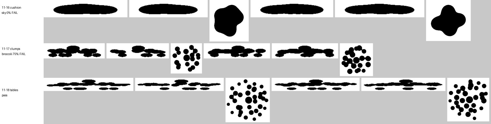

# Review 2026-11-20 03:36 UTC (cloud, reviewer + builder)

Mode: **reviewer then builder**. The last build commit (`819d978`, 11-20 00:45) was ~3 h old. No owner reply (no
laptop commits since the final film on 11-18, no issues), so no scene, design or render was touched.

## Health

* Main `819d978`: `ruff check` / `ruff format --check` clean on `src tests adapters scripts`; **282 unit tests pass**
  (+5 new), 38 skipped (no Blender). `continuity_check.py` prints the same 3 findings as before (the `actor_overlap`
  marks waiting for the owner's notes), plus 0 for the new check.
* Licences: nothing new (numpy and Pillow only; scipy deliberately not added).
* No new sheets, clips or renders.

## Looked at: the acacias, three versions

The 11-16 set still (`cc74f57`'s `set_midday.jpg`): one smooth green cushion on a stalk, flat but solid, and a white
stripe along the horizon. The 11-17 set still (the committed `savannah-set-tests/set_midday.jpg`): the canopy is a
dozen round green florets stacked at different heights: this is the broccoli. The film (0:08, 0:40, 1:40, 2:30):
wide, thin layered shelves with sky between them, reading as umbrella thorns from a distance; close up the shelves
are still a little coin-like (discs), but they are flat. Pass.

Rows: cushion, broccoli, tables. Per row: two side views and the top view for seeds 7 and 18, from the metaball field.

## Built (DECISIONS #98): `set_canopy`

Blender's metaball field evaluated exactly (no Blender), 4 cm × scale grid; per acacia in each scene's layout:

| canopy | table (min 3) | sky (min 5 %) | round florets (max 5 %) | |
|---|---|---|---|---|
| 11-16 cushion (`cc74f57`) | 5.3–5.5 | 0–0.7 % | 0 % | fail ×28 |
| 11-17 clumps (`fd4ee90`) | 3.8–4.9 | 12–24 % | 8–64 % (roundest 1.4–2.3:1) | fail ×28 |
| 11-18 tables (main) | 6.4–7.6 | 14–25 % | 0 % (roundest 3.0–3.5:1) | pass ×28 |

28 = seeds 1–79 step 6 × scales 1.0 and 0.85. The broccoli's proportions alone would pass a width/depth test: what
separates it is the shape of each clump, which is why the check measures clumps, not just the crown. Runs in
`continuity_check.py` (the animatic gate) and in every `savannah_scene.py` build.

LESSONS' eye-only list now holds two items, both at the animatic gate: the horizon stripe and the static opening.

## Scores (no design or film changes)

| | score | note |
|---|---|---|
| Film | 7 | unchanged; voices and music need the owner's ears |
| Tembo | 9 | locked |
| Neema | 8 | eyes bulge from the front, far brow outside the head |
| Bibi Kobe | 8 | barrel shell (0.53), far brow |
| Kiki | 6 | mongoose on all fours; kangaroo sentinel |
| Zuri | 7 | mane stops halfway up the neck; horse/donkey read |
| Design-stage tooling | 9 | every known design failure measured; set checks have begun for the animatic gate |

## Queue

P0-FILM still waits for the owner's film notes and the laptop. Next cloud item: measure the horizon stripe on
rendered frames (calibrate with the 11-16 still failing and the film passing), then the static-opening check
against the animatic's shot motion.
