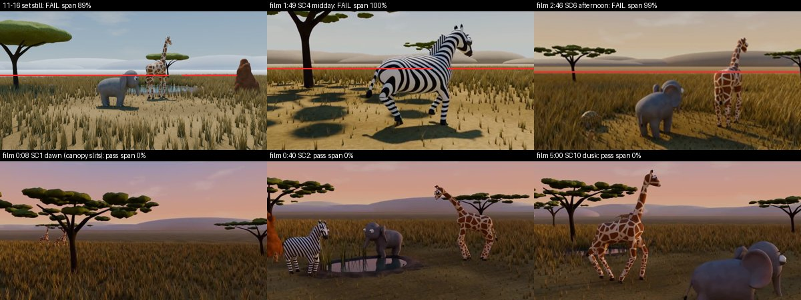

# Review 2026-11-20 06:36 UTC (cloud, reviewer + builder)

Mode: **reviewer then builder**. The last build commit (`992aa97`, 11-20 03:49) was ~3 h old. No owner reply (no
laptop commits since the final film on 11-18, no issues), so no scene, design or render was touched.

## Health

* Main `992aa97`: `ruff check` / `ruff format --check` clean on `src tests adapters scripts`; **293 unit tests pass**
  (+11 new), 38 skipped (no Blender). `continuity_check.py`: unchanged (the 3 `actor_overlap` marks wait for the
  owner's notes).
* Licences: nothing new (numpy, Pillow, ffmpeg already used). The six calibration frames in `tests/data/frames`
  are the project's own renders, 320×180.
* No new sheets, clips or renders.

## Looked at: the horizon, set stills → animatic → film

Red line = the stripe the check found. Top: the 11-16 set still (white strip), the film at 1:49 (SC 4, midday) and
2:46 (SC 6, afternoon). Bottom: dawn, morning and dusk wides from the film, which pass.

The 11-16 still has the owner's white strip. The committed 11-17 set stills (dawn, midday, sunset) still have it as a
pale tan strip. Stage 1 wrote "the white horizon stripe is gone", and in the dawn and dusk scenes it is. **In the
midday and afternoon wides of SC 4–6 a flat, pale bare-ground band still lies under the hills**: toned down from white
to tan, but it still reads as a painted line across the frame. Earlier reviews (mine included) called the film a pass
on this note; on those wides it is not. Parked with the owner's other set notes until after the animatic (new P0-FILM item).

## Built (DECISIONS #99): `horizon_stripe`

`animatica.sets.frames.horizon_stripe`: a thin band (1–4 % of the height) brighter than the rows above and below
(≥ 0.08 luminance), on a row most columns share, laid as a straight, even line (row RMS ≤ 0.6 % of the height,
thickness SD ≤ 1.5 rows) spanning ≥ 80 % of the width and drawn along ≥ 50 % of it.

| frames | result |
|---|---|
| 11-16 set still | fail (span 89 %) |
| 11-17 set stills: dawn, midday, sunset / night | fail ×3 / pass (too dim) |
| final film, 1 frame/s | 19 of 317 fail: SC 4 1:41–2:15, SC 5 2:26, SC 6 2:43–3:02; dawn, dusk, night pass |
| animatic v2, 1 frame/s | 4 fail: SC 4 ×3, SC 9 4:36 (a dim night band: borderline) |

Sky between the acacia shelves made the first draft cry wolf (dawn wides). Those runs are wavy and uneven and are
now rejected; three such frames are in the test set. The check is conservative: a band the cast cuts to under half
the width is missed (animatic 1:43). `scripts/frame_check.py` runs it on any still or video;
`savannah_animatic.py` measures every shot's middle frame (soft, `horizon_stripes` in `animatic.json`).

LESSONS' eye-only list now holds one item: the static opening. `savannah_animatic.static_shots` exists but has no
regression test, and nothing measures a scene-level "nothing happens" stretch across cuts.

## Scores (no design or film changes)

| | score | note |
|---|---|---|
| Film | 7 | unchanged; horizon band in SC 4–6 wides (known now, was scored in "visuals 7") |
| Tembo | 9 | locked |
| Neema | 8 | eyes bulge from the front, far brow outside the head |
| Bibi Kobe | 8 | barrel shell (0.53), far brow |
| Kiki | 6 | mongoose on all fours; kangaroo sentinel |
| Zuri | 7 | mane stops halfway up the neck; horse/donkey read |
| Design-stage tooling | 9 | every design catch measured; set checks: canopy (built), horizon (frames) |

## Queue

P0-FILM still waits for the owner's film notes and the laptop. Next cloud item: the static opening (a regression
test for `static_shots` with the old 22 s opening failing, then a scene-level measure across cuts).
