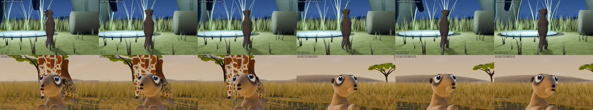

# Review 2026-11-20 09:36 UTC (cloud, reviewer + builder)

Mode: **reviewer then builder**. The last build commit (`e378190`, 11-20 06:49) was ~3 h old. No owner reply (no
laptop commits since the final film on 11-18, no issues), so no design, render or scene was changed; one annotation
(`"hold": true` on SC 10's end-card shot) renders the same.

## Health

* Main `e378190`: `ruff check` / `ruff format --check` clean on `src tests adapters scripts`; **297 unit tests pass**
  (+4 new), 38 skipped (no Blender).
* Licences: nothing new (pure Python). `tests/data/sc01_2026-11-16.json` is the project's own scene spec from git
  (`0be37cd^`).
* No new sheets, clips or renders.

## Looked at: what the per-shot static check can't see

Top: SC 9's last 12 s in animatic v2 (4:43–4:55): Kiki stands still with her back to the glowing spring, cut into
parts from slightly different angles. Bottom: the end of SC 5 (2:35–2:43): a silent Kiki close-up, two angles, she
doesn't move.

`savannah_animatic.static_shots` had no test. Writing one showed the gap: every shot pushes in and orbits
(`shot_move`), so it **passes the owner's 22 s empty opening** (each set shot "moves" > 2 % of the frame), and a cut
resets any per-shot measure. What the owner saw was that nothing *happens*, so the new check ignores both the camera
and the cuts.

## Built (DECISIONS #100): `dead_air`

`animatica.production.pacing.dead_air`, in `continuity_check.py --cameras` (approximate cameras, ~1 s a scene,
before any render). Every 0.25 s: is an animal in frame and readable (≥ 2 % of the frame) travelling ≥ 2 % of the
frame on the film in 1 s through the same camera, turning ≥ 15°, speaking on screen, gesturing or changing
expression; or is a flock, a moving prop or the spring's burst in frame? A run > 4.5 s with none fails. `hold` on a
shot marks a deliberate still (the end card is the only one).

| input | result |
|---|---|
| SC 1 as of 11-16 (empty set, 2 shots) | fail: one 22.0 s run across both shots |
| SC 1 today (giraffes, zebras, 2 flocks) | pass; all three kinds of life found |
| the film | 3 findings, all confirmed on animatic v2 by eye: SC 9 28–40 s (climax, 11.8 s), SC 5 18.5–26 s (7.5 s), SC 7 0–5 s (5.0 s) |

The SC 9 one overlaps the open climax item (Kiki from behind, `facing_away`): the same fix (the spring's song on her
face, a reaction) cures both. Known limits: breathing, blinks and eyeline turns aren't counted; cloud timings come
from word-count estimates, so times can be a few seconds off the laptop's.

LESSONS' "still caught only by eye" list is now empty: every owner and review catch has a check and a test.

## Scores (no design or film changes)

| | score | note |
|---|---|---|
| Film | 7 | unchanged; three dead-air stretches known now (the SC 9 one was already scored in "climax") |
| Tembo | 9 | locked |
| Neema | 8 | eyes bulge from the front, far brow outside the head |
| Bibi Kobe | 8 | barrel shell (0.53), far brow |
| Kiki | 6 | mongoose on all fours; kangaroo sentinel |
| Zuri | 7 | mane stops halfway up the neck; horse/donkey read |
| Design-stage tooling | 9 | every known catch measured; the gate still depends on the owner's eyes for taste |

## Queue

Everything left in P0-FILM and P0-DESIGN waits for the owner's notes (designs are locked; scenes paused) or the
laptop (re-renders). Next cloud item if he stays silent: run `dead_air`, `horizon_stripe` and the staging checks on
the laptop's real shot reports (`savannah_scene.py` already writes `location` / `end_location` per shot), so the
animatic's own report lists dead air too, not only the approximate cameras.
